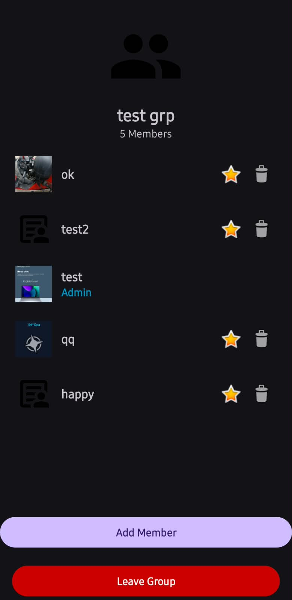

# ConnectHub

### A social media and real-time chat app for Android

Built with Java, Firebase, Cloudinary and Material Design 3.

<p align="center">


<br>


</p>

---

## Contents

- [Overview](#overview)
- [Support the project](#support-the-project)
- [Screenshots](#screenshots)
- [Features](#features)
  - [Authentication](#authentication)
  - [Home feed](#home-feed)
  - [User profiles](#user-profiles)
  - [Real-time chat](#real-time-chat)
  - [Message delivery and read states](#message-delivery-and-read-states)
  - [Voice messaging](#voice-messaging)
  - [Media messaging](#media-messaging)
  - [Message interaction](#message-interaction)
  - [Social features](#social-features)
- [Tech stack](#tech-stack)
- [Project structure](#project-structure)
- [Architecture](#architecture)
- [Implemented features](#implemented-features)
- [Upcoming features](#upcoming-features)
- [Installation](#installation)
- [What I learned](#what-i-learned)
- [Contributing](#contributing)
- [Developer](#developer)
- [License](#license)

---

## Overview

ConnectHub is an Android app I built to put social media and messaging in one place. You can post, like, comment and follow people like on a normal social app, and you can also chat with them one-to-one or in groups, send voice notes and images, and see when your messages have been read.

It's written in Java using Android Studio. Firebase Authentication handles login, and Cloud Firestore stores the data and powers the real-time parts. Media (profile pictures, chat images and so on) goes to Cloudinary, so Firestore only has to hold the links.

The main things I wanted to practise while building it:

- Real-time communication
- Social networking features
- Group messaging
- Delivery and read receipts
- Media uploading
- Voice messages
- User presence
- Typing indicators
- RecyclerView optimization
- A repository-style architecture

---

## Support the project

If ConnectHub looks useful or interesting to you, a star on the repo would be really appreciated. It keeps me motivated to keep working on it.

<p align="center">

<a href="https://github.com/Indra9555/ConnectHub">

</a>

</p>

---

## Screenshots

<p align="center">
  
  
  
</p>

<p align="center">
  
  
  
</p>

<p align="center">
  
  
  
</p>

### Screens in the app

| Screen | What it does |
| :--- | :--- |
| Login | Sign in to your account |
| Register | Create a new account |
| Home | Social media feed |
| Profile | User profile and their posts |
| Search | Find other users |
| Notifications | Activity on your account |
| Private chat | One-to-one real-time messaging |
| Group chat | Real-time group messaging |
| Comments | Comments on a post |

---

## Features

### Authentication

Login and registration run on Firebase Authentication.

- Registration and login
- Auto login
- Logout
- Handling of the authentication state

### Home feed

The home feed is the main social part of the app.

- Create posts
- Image posts
- Like posts
- Comments
- Real-time feed updates
- Search users
- Interactive post content

### User profiles

Users can manage their own profile.

- Profile page and edit profile
- Profile picture
- Bio
- User information
- User's posts

Profile pictures are uploaded to Cloudinary.

### Real-time chat

Private and group chats both run on Cloud Firestore, so messages show up instantly.

#### Private chat

- One-to-one messaging
- Real-time messages
- Text, image and voice messages
- Typing indicator
- Online / offline status
- Last seen
- Read receipts
- Message replies
- Emoji reactions
- Message deletion

#### Group chat

- Group creation
- Group messaging
- Real-time group messages
- Member management
- Membership tracking and history
- Replies, reactions and deletion in groups
- Per-member delivery tracking
- Per-member read tracking

### Message delivery and read states

Both private and group chats track whether a message was delivered and read.

#### Private messages

```text
✓   Sent
✓✓  Seen
```

The state is stored in Firestore and the chat UI updates from it.

#### Group messages

In groups, each message keeps delivery and read info for every member separately. Every message has two fields:

```text
deliveredTo
seenBy
```

For example:

```text
deliveredTo:
{
    userA: true,
    userB: true,
    userC: false
}
```

and:

```text
seenBy:
{
    userA: true,
    userB: false,
    userC: false
}
```

From this the app can work out:

- Whether the message was sent
- Whether other members received it
- Whether members opened the chat
- Whether members have seen the message
- Whether everyone relevant has seen it

#### Group read receipts

When a received message becomes visible to a group member, their entry in `seenBy` is updated automatically. The sender's own message counts as delivered and seen by the sender from the start.

### Voice messaging

Voice messages are fully supported.

#### Recording

- Hold to record
- Slide to cancel
- Recording timer
- Cancel gesture
- Audio permission handling

#### Playback

- Waveform visualization
- Seekable playback
- Pause / resume
- Playback progress
- Playback speed: 1×, 1.5× and 2×

### Media messaging

Images can be shared inside conversations.

- Image messages
- Cloudinary image upload
- Glide image loading
- Upload state handling
- Full-screen image viewer
- Image preview

### Message interaction

I tried to get the messaging to feel like the apps people already use.

#### Replies

- Swipe to reply
- Reply preview
- Reply to text, image and voice messages
- Tap a reply to scroll to the original message

#### Reactions

- Emoji reactions
- Double tap for a ❤️ reaction
- Reaction summary
- Multiple reactions on one message

#### Message actions

- Long press context menu
- Copy message
- Delete for everyone
- Delete for me
- Message ID tracking

#### UI and performance

- Stable RecyclerView message IDs
- DiffUtil-based updates
- Smooth message animations
- A message map for quick reply lookup
- Real-time Firestore listeners

### Social features

- Like system
- Comment system
- Follow users
- Notifications
- User search
- Real-time feed updates

---

## Tech stack

| Technology | Used for |
| :--- | :--- |
| Java | Android development |
| Android Studio | Development environment |
| Firebase Authentication | User authentication |
| Cloud Firestore | Real-time database and messaging |
| Cloudinary | Media storage |
| Glide | Image loading |
| RecyclerView | Lists |
| DiffUtil | Efficient RecyclerView updates |
| Material Design 3 | UI |
| MediaRecorder | Voice recording |
| MediaPlayer | Voice playback |
| WaveformSeekBar | Audio waveform |
| Git | Version control |
| GitHub | Source code hosting |

---

## Project structure

```text
ConnectHub
│
├── app
│   │
│   ├── manifests
│   │
│   ├── kotlin+java
│   │   └── com.example.connecthub
│   │
│   │       ├── activities
│   │       │   ├── AddGroupMemberActivity
│   │       │   ├── ChatActivity
│   │       │   ├── ChatListActivity
│   │       │   ├── CommentActivity
│   │       │   ├── CreateGroupActivity
│   │       │   ├── CreatePostActivity
│   │       │   ├── EditProfileActivity
│   │       │   ├── GroupInfoActivity
│   │       │   ├── GroupListActivity
│   │       │   ├── ImageViewerActivity
│   │       │   ├── LoginActivity
│   │       │   ├── MainActivity
│   │       │   ├── NotificationActivity
│   │       │   ├── ProfileActivity
│   │       │   ├── RegisterActivity
│   │       │   ├── SearchActivity
│   │       │   └── SplashActivity
│   │       │
│   │       ├── adapters
│   │       │   ├── AddMemberAdapter
│   │       │   ├── ChatUserAdapter
│   │       │   ├── CommentAdapter
│   │       │   ├── GroupAdapter
│   │       │   ├── GroupMemberAdapter
│   │       │   ├── MessageAdapter
│   │       │   ├── MessageDiffCallback
│   │       │   ├── NotificationAdapter
│   │       │   ├── PostAdapter
│   │       │   ├── SelectMembersAdapter
│   │       │   └── UserAdapter
│   │       │
│   │       ├── chat
│   │       │   ├── ChatRepository
│   │       │   ├── ChatUploadManager
│   │       │   ├── PresenceManager
│   │       │   ├── TypingManager
│   │       │   ├── VoiceUploadManager
│   │       │   └── WaveformGenerator
│   │       │
│   │       ├── firebase
│   │       │   └── FirebaseManager
│   │       │
│   │       ├── helpers
│   │       │   ├── ChatHelper
│   │       │   ├── FollowHelper
│   │       │   ├── LikeHelper
│   │       │   ├── NotificationHelper
│   │       │   ├── SwipeToReplyCallback
│   │       │   └── TimeUtils
│   │       │
│   │       ├── managers
│   │       │   └── ZegoManager
│   │       │
│   │       ├── models
│   │       │   ├── ChatUser
│   │       │   ├── Comment
│   │       │   ├── Group
│   │       │   ├── GroupMemberInfo
│   │       │   ├── MembershipPeriod
│   │       │   ├── Message
│   │       │   ├── Notification
│   │       │   ├── Post
│   │       │   └── User
│   │       │
│   │       ├── network
│   │       │   └── CloudinaryUploader
│   │       │
│   │       ├── repository
│   │       │
│   │       ├── services
│   │       │   └── MyFirebaseMessagingService
│   │       │
│   │       ├── utils
│   │       │   ├── CloudinaryConfig
│   │       │   └── ValidationUtils
│   │       │
│   │       └── zego
│   │           └── ZegoConfig
│   │
│   └── ConnectHubApp
│
├── functions
│
├── gradle
│
└── README.md
```

---

## Architecture

The app is split into layers: UI, app logic, backend communication and media handling.

```text
                         ┌───────────────────────────┐
                         │       ConnectHub App      │
                         │     Android Application   │
                         └─────────────┬─────────────┘
                                       │
                                       ▼
                    ┌──────────────────────────────────┐
                    │          Presentation Layer      │
                    │                                  │
                    │  Activities                      │
                    │  • MainActivity                  │
                    │  • ChatActivity                  │
                    │  • ProfileActivity               │
                    │  • CreatePostActivity            │
                    │  • GroupInfoActivity             │
                    │  • NotificationActivity          │
                    │  • SearchActivity                │
                    │  • Login / Register              │
                    │  • Comments / Groups / etc.      │
                    └───────────────┬──────────────────┘
                                    │
                    ┌───────────────┼──────────────────┐
                    │               │                  │
                    ▼               ▼                  ▼
          ┌────────────────┐ ┌───────────────┐ ┌─────────────────┐
          │    Adapters    │ │ Chat Managers │ │    Helpers      │
          │                │ │               │ │                 │
          │ PostAdapter    │ │ ChatRepository│ │ LikeHelper      │
          │ MessageAdapter │ │ UploadManager │ │ FollowHelper    │
          │ GroupAdapter   │ │ TypingManager │ │ ChatHelper      │
          │ CommentAdapter │ │ PresenceMgr   │ │ Notification    │
          │ UserAdapter    │ │ VoiceManager  │ │ SwipeToReply    │
          └───────┬────────┘ │ WaveformGen.  │ └────────┬────────┘
                  │          └───────┬───────┘          │
                  │                  │                  │
                  └──────────────────┼──────────────────┘
                                     │
                                     ▼
                         ┌─────────────────────────┐
                         │       Model Layer       │
                         │                         │
                         │ User                    │
                         │ Post                    │
                         │ Comment                 │
                         │ Message                 │
                         │ Group                   │
                         │ GroupMemberInfo         │
                         │ MembershipPeriod        │
                         │ Notification            │
                         │ ChatUser                │
                         └────────────┬────────────┘
                                      │
                                      ▼
                     ┌─────────────────────────────────┐
                     │       Data / Repository Layer   │
                     │                                 │
                     │ ChatRepository                  │
                     │ FirebaseManager                 │
                     │ Firestore Operations            │
                     └───────────────┬─────────────────┘
                                     │
                  ┌──────────────────┼──────────────────┐
                  │                  │                  │
                  ▼                  ▼                  ▼
        ┌──────────────────┐ ┌────────────────┐ ┌─────────────────┐
        │ Firebase         │ │   Cloudinary   │ │  FCM / Services │
        │                  │ │                │ │                 │
        │ Authentication   │ │ Image Uploads  │ │ Notifications   │
        │ Cloud Firestore  │ │ Media Storage  │ │ Messaging       │
        └──────────────────┘ └────────────────┘ └─────────────────┘
```

### Main building blocks

- Activity-based Android UI
- Repository layer
- Firebase Authentication
- Cloud Firestore with real-time listeners
- Cloudinary media storage
- RecyclerView and DiffUtil
- Model classes for data handling
- Helper and utility classes

---

## Implemented features

### Authentication

- [x] Firebase Authentication
- [x] Registration
- [x] Login
- [x] Auto login
- [x] Logout

### Profiles

- [x] User profiles
- [x] Edit profile
- [x] Profile pictures
- [x] Bio
- [x] User information
- [x] User posts

### Social feed

- [x] Create posts
- [x] Image posts
- [x] Like system
- [x] Comment system
- [x] Search users
- [x] Real-time feed

### Private chat

- [x] One-to-one chat
- [x] Real-time messaging
- [x] Text messages
- [x] Image messages
- [x] Voice messages
- [x] Typing indicator
- [x] Online / offline status
- [x] Last seen
- [x] Read receipts
- [x] Message replies
- [x] Emoji reactions
- [x] Double tap reactions
- [x] Delete for everyone
- [x] Delete for me
- [x] Full-screen image viewer

### Group chat

- [x] Group creation
- [x] Group messaging
- [x] Real-time group messages
- [x] Group member management
- [x] Membership history
- [x] Membership-based message visibility
- [x] Group message replies
- [x] Group reactions
- [x] Group message deletion
- [x] Per-member delivery tracking
- [x] Per-member read tracking
- [x] Group read receipts

### Voice messaging

- [x] Voice recording
- [x] Hold to record
- [x] Slide to cancel
- [x] Recording timer
- [x] Waveform visualization
- [x] Seekable playback
- [x] Pause / resume
- [x] Playback speed (1× / 1.5× / 2×)

### Performance and UI

- [x] RecyclerView
- [x] Stable message IDs
- [x] DiffUtil
- [x] Smooth message animations
- [x] Firestore real-time listeners
- [x] Message map for reply lookup
- [x] Real-time UI updates

---

## Upcoming features

Things I plan to add next:

- [ ] Edit messages
- [ ] Push notifications with FCM
- [ ] Stories
- [ ] Video messages
- [ ] Voice calls
- [ ] Video calls
- [ ] Dark mode
- [ ] Message search
- [ ] Starred messages
- [ ] Chat wallpaper
- [ ] User blocking
- [ ] End-to-end encryption
- [ ] Advanced group management
- [ ] Group member roles and permissions

---

## Installation

### 1. Clone the repository

```bash
git clone https://github.com/Indra9555/ConnectHub.git
```

### 2. Open the project

Open the cloned folder in Android Studio.

### 3. Set up Firebase

Add your own Firebase config file here:

```text
app/google-services.json
```

Then enable these services in your Firebase project:

- Firebase Authentication
- Cloud Firestore

### 4. Set up Cloudinary

Add your own Cloudinary credentials in the app's Cloudinary config (`utils/CloudinaryConfig`).

### 5. Sync Gradle

Let Android Studio download and set up all the dependencies.

### 6. Run the app

Connect an Android device or start an emulator, then run the app.

---

## What I learned

Building ConnectHub gave me hands-on practice with:

- Android development with Java
- Android Studio
- Firebase Authentication
- Cloud Firestore and its real-time listeners
- Real-time messaging
- Group messaging design
- Message delivery tracking
- Read receipt systems
- Cloudinary integration and media uploading
- Voice recording and playback
- RecyclerView and DiffUtil
- Material Design 3
- The repository pattern and clean architecture ideas
- Git and GitHub
- Building real-time apps in general

---

## Contributing

Suggestions, bug reports and feature ideas are all welcome.

```text
Fork the repository
        ↓
Create a feature branch
        ↓
Make your changes
        ↓
Test them
        ↓
Commit
        ↓
Push
        ↓
Open a pull request
```

If you find a bug or have an idea to make ConnectHub better, feel free to open an issue.

---

## Developer

**Indrajeet Verma**
B.Tech Computer Science student

Android Developer • Java • Firebase • Cloud Computing

<p align="center">

<a href="https://github.com/Indra9555">

</a>

</p>

---

## License

ConnectHub is built for learning, portfolio and educational purposes.

---

<p align="center">

⭐ <b>Built with Java, Firebase, Cloudinary and a lot of learning.</b> ⭐

<br><br>

<b>ConnectHub: connecting people, one message at a time.</b>

</p>
