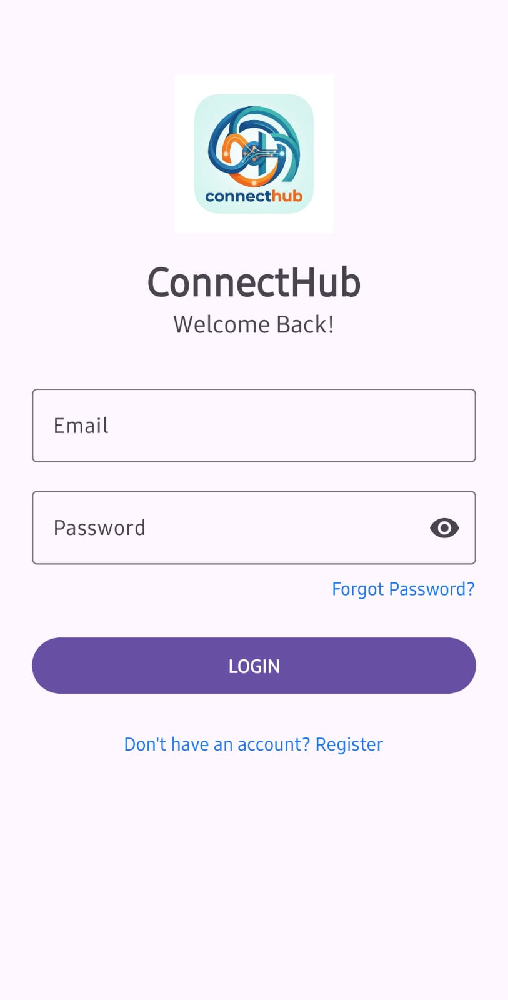
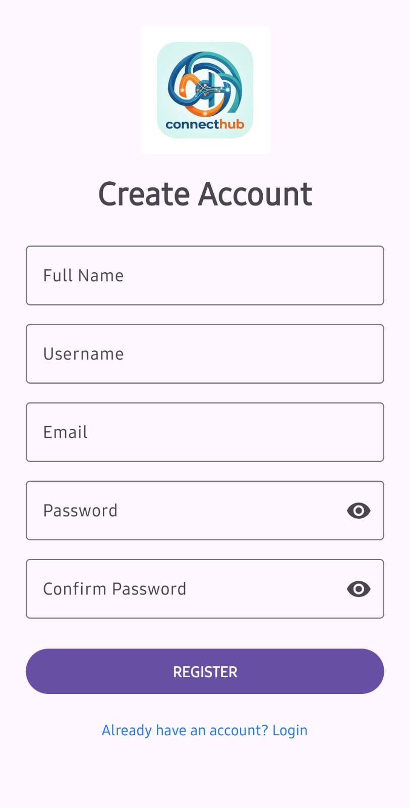
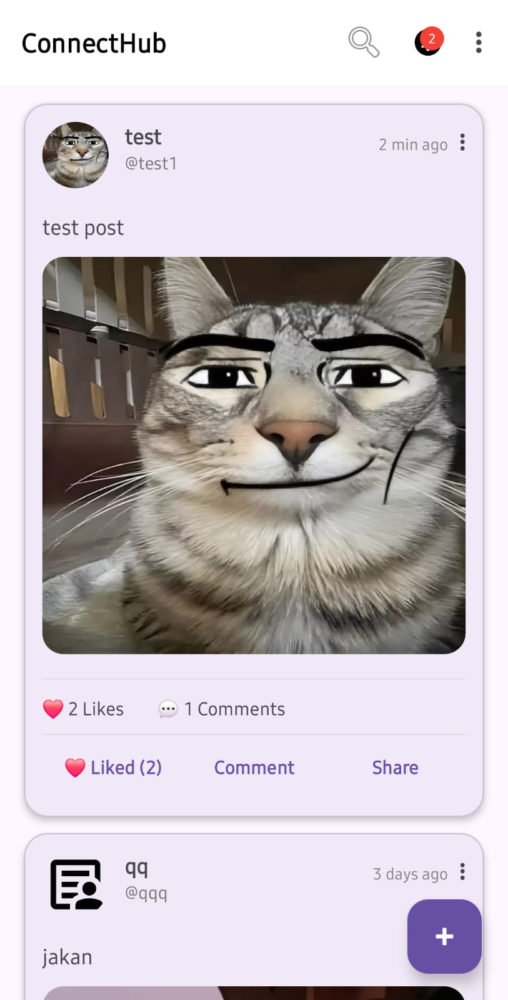
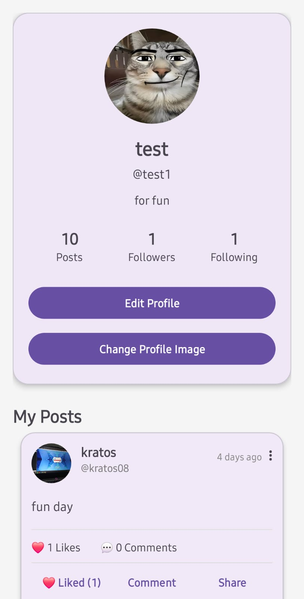
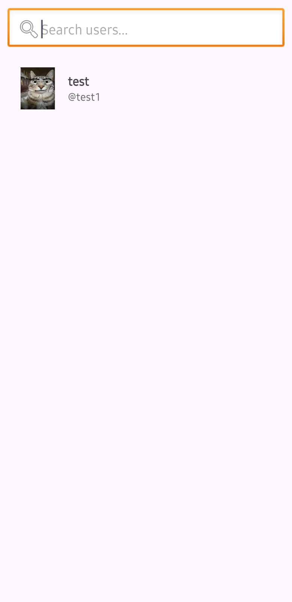
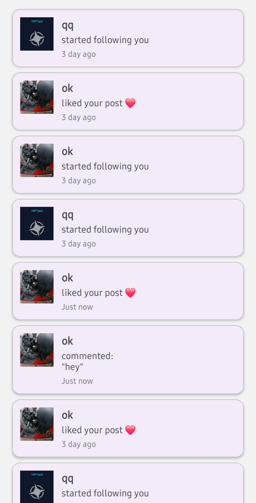
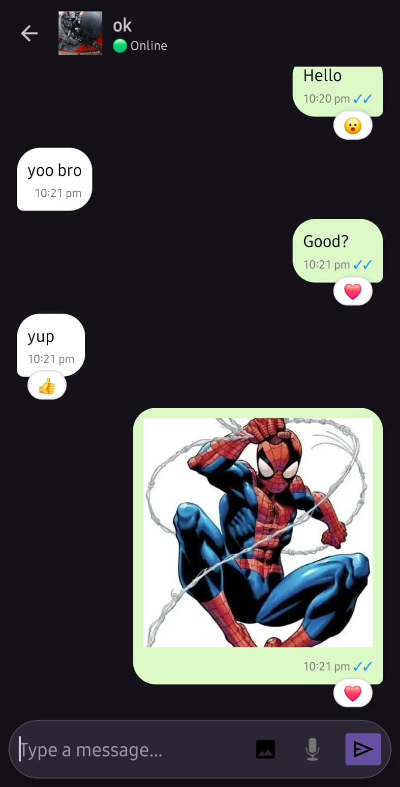
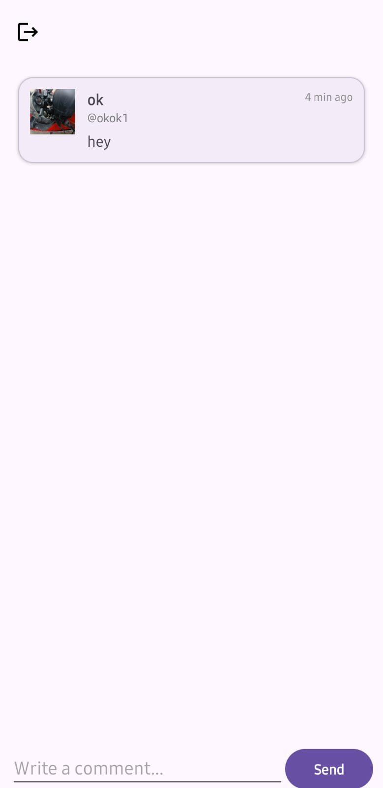

# 📱 ConnectHub

### A Modern Social Media & Real-Time Chat Application for Android

Built with **Java**, **Firebase**, **Cloudinary**, and **Material Design 3**.

<p align="center">


<br>


</p>

---

# ✨ Overview

**ConnectHub** is a modern Android social networking application designed to combine social media, real-time communication, and interactive messaging into a single platform.

The application is built using **Java** and **Android Studio**, with **Firebase Authentication** and **Cloud Firestore** powering authentication, data storage, and real-time communication.

For media storage, ConnectHub uses **Cloudinary**, allowing media files such as profile pictures and chat images to be handled independently from Firestore.

The project focuses on implementing real-world Android application concepts including:

* Real-time communication
* Social networking
* Group messaging
* Message delivery and read receipts
* Media uploading
* Voice messaging
* User presence
* Typing indicators
* RecyclerView optimization
* Repository-based architecture

---

# 📑 Quick Navigation

* [✨ Overview](#-overview)
* [⭐ Support the Project](#-support-the-project)
* [🎥 Demo](#-demo)
* [📸 Screenshots](#-screenshots)
* [🚀 Features](#-features)

  * [Authentication](#-authentication)
  * [Home Feed](#-home-feed)
  * [User Profiles](#-user-profiles)
  * [Real-Time Chat](#-real-time-chat)
  * [Message Delivery & Read States](#-message-delivery--read-states)
  * [Voice Messaging](#-voice-messaging)
  * [Media Messaging](#-media-messaging)
  * [Message Interaction](#-message-interaction)
  * [Social Features](#-social-features)
* [🛠 Tech Stack](#-tech-stack)
* [📂 Project Structure](#-project-structure)
* [🏗 Architecture](#-architecture)
* [✅ Implemented Features](#-implemented-features)
* [🚧 Upcoming Features](#-upcoming-features)
* [⚙️ Installation](#️-installation)
* [📖 Learning Outcomes](#-learning-outcomes)
* [🤝 Contributing](#-contributing)
* [👨‍💻 Developer](#-developer)
* [📄 License](#-license)

---

# ⭐ Support the Project

If you find **ConnectHub** useful or interesting, consider giving the repository a ⭐ **Star**.

It helps support the project and motivates continued development.

<p align="center">

<a href="https://github.com/Indra9555/ConnectHub">

</a>

</p>

---

# 🎥 Demo

> 🚧 Demo video coming soon.

---

# 📸 Screenshots

<p align="center">
  
  
  
</p>

<p align="center">
  
  
  
</p>

<p align="center">
  
  
</p>

### 📱 Available Screens

| Screen           | Description                 |
| :--------------- | :-------------------------- |
| 🔐 Login         | User authentication         |
| 📝 Register      | New user registration       |
| 🏠 Home          | Social media feed           |
| 👤 Profile       | User profile and posts      |
| 🔎 Search        | Search for users            |
| 🔔 Notifications | User activity notifications |
| 💬 Chat          | Real-time messaging         |
| 💭 Comments      | Post comment system         |

---

# 🚀 Features

## 🔐 Authentication

ConnectHub uses **Firebase Authentication** for user authentication.

* Firebase Authentication
* User Registration
* Login
* Auto Login
* Logout
* Authentication State Handling

---

# 🏠 Home Feed

The home feed provides the main social networking experience.

* Create Posts
* Image Posts
* Like Posts
* Comment System
* Real-Time Feed Updates
* Search Users
* Interactive Post Content

---

# 👤 User Profiles

Users can manage their personal profile information.

* User Profiles
* Edit Profile
* Profile Picture
* Bio
* User Information
* User Posts

Profile images are uploaded using **Cloudinary**.

---

# 💬 Real-Time Chat

ConnectHub provides real-time private and group communication using **Cloud Firestore**.

## Private Chat

* One-to-One Messaging
* Real-Time Messages
* Text Messages
* Image Messages
* Voice Messages
* Typing Indicator
* Online / Offline Status
* Last Seen
* Read Receipts
* Message Replies
* Emoji Reactions
* Message Deletion

## Group Chat

* Group Creation
* Group Messaging
* Real-Time Group Messages
* Group Member Management
* Group Membership Tracking
* Membership History
* Group Message Replies
* Group Reactions
* Group Message Deletion
* Per-Member Delivery Tracking
* Per-Member Read Tracking

---

# ✓ Message Delivery & Read States

ConnectHub supports message delivery and read tracking for both private and group conversations.

## Private Messages

Private messages support:

```text
✓   Sent
✓✓  Seen
```

The message state is updated using Firestore and reflected in the chat UI.

---

## Group Messages

Group messages maintain separate delivery and read information for individual members.

Each message can contain:

```text
deliveredTo
seenBy
```

Example:

```text
deliveredTo:
{
    userA: true,
    userB: true,
    userC: false
}
```

and:

```text
seenBy:
{
    userA: true,
    userB: false,
    userC: false
}
```

This allows the application to determine:

* Whether a message was sent
* Whether another member received it
* Whether members opened the chat
* Whether members have seen the message
* Whether all relevant members have seen it

### Group Read Receipts

When a received message becomes visible to a group member, ConnectHub automatically updates its `seenBy` state.

The sender's own message is automatically considered delivered and seen by the sender.

---

# 🎤 Voice Messaging

ConnectHub includes a complete voice messaging system.

### Recording

* Hold to Record
* Slide to Cancel
* Recording Timer
* Cancel Gesture
* Audio Permission Handling

### Playback

* Waveform Visualization
* Seekable Playback
* Pause / Resume
* Playback Speed
* 1× Speed
* 1.5× Speed
* 2× Speed
* Playback Progress

---

# 📷 Media Messaging

ConnectHub supports media sharing inside conversations.

* Image Messages
* Cloudinary Image Upload
* Glide Image Loading
* Upload State Handling
* Full-Screen Image Viewer
* Image Preview

---

# 💬 Message Interaction

ConnectHub provides interactive messaging features inspired by modern messaging applications.

### Replies

* Swipe to Reply
* Reply Preview
* Reply to Text Messages
* Reply to Image Messages
* Reply to Voice Messages
* Scroll to Original Message

### Reactions

* Emoji Reactions
* Double Tap ❤️ Reaction
* Reaction Summary
* Multiple Reaction Support

### Message Actions

* Long Press Context Menu
* Copy Message
* Delete for Everyone
* Delete for Me
* Message ID Tracking

### UI & Performance

* Stable RecyclerView Message IDs
* DiffUtil-Based Updates
* Smooth Message Animations
* Efficient Message Map for Reply Lookup
* Real-Time Firestore Listeners

---

# ❤️ Social Features

ConnectHub also includes social networking functionality.

* Like System
* Comment System
* Follow Users
* Notifications
* User Search
* Real-Time Feed Updates

---

# 🛠 Tech Stack

| Technology                  | Purpose                        |
| :-------------------------- | :----------------------------- |
| **Java**                    | Android Development            |
| **Android Studio**          | Development Environment        |
| **Firebase Authentication** | User Authentication            |
| **Cloud Firestore**         | Real-Time Database & Messaging |
| **Cloudinary**              | Media Storage                  |
| **Glide**                   | Image Loading                  |
| **RecyclerView**            | Dynamic Lists                  |
| **DiffUtil**                | Efficient RecyclerView Updates |
| **Material Design 3**       | Modern Android UI              |
| **MediaRecorder**           | Voice Recording                |
| **MediaPlayer**             | Voice Playback                 |
| **WaveformSeekBar**         | Audio Waveform                 |
| **Git**                     | Version Control                |
| **GitHub**                  | Source Code Management         |

---
# 📂 Project Structure

```text
ConnectHub
│
├── app
│   │
│   ├── manifests
│   │
│   ├── kotlin+java
│   │   └── com.example.connecthub
│   │
│   │       ├── activities
│   │       │   ├── AddGroupMemberActivity
│   │       │   ├── ChatActivity
│   │       │   ├── ChatListActivity
│   │       │   ├── CommentActivity
│   │       │   ├── CreateGroupActivity
│   │       │   ├── CreatePostActivity
│   │       │   ├── EditProfileActivity
│   │       │   ├── GroupInfoActivity
│   │       │   ├── GroupListActivity
│   │       │   ├── ImageViewerActivity
│   │       │   ├── LoginActivity
│   │       │   ├── MainActivity
│   │       │   ├── NotificationActivity
│   │       │   ├── ProfileActivity
│   │       │   ├── RegisterActivity
│   │       │   ├── SearchActivity
│   │       │   └── SplashActivity
│   │       │
│   │       ├── adapters
│   │       │   ├── AddMemberAdapter
│   │       │   ├── ChatUserAdapter
│   │       │   ├── CommentAdapter
│   │       │   ├── GroupAdapter
│   │       │   ├── GroupMemberAdapter
│   │       │   ├── MessageAdapter
│   │       │   ├── MessageDiffCallback
│   │       │   ├── NotificationAdapter
│   │       │   ├── PostAdapter
│   │       │   ├── SelectMembersAdapter
│   │       │   └── UserAdapter
│   │       │
│   │       ├── chat
│   │       │   ├── ChatRepository
│   │       │   ├── ChatUploadManager
│   │       │   ├── PresenceManager
│   │       │   ├── TypingManager
│   │       │   ├── VoiceUploadManager
│   │       │   └── WaveformGenerator
│   │       │
│   │       ├── firebase
│   │       │   └── FirebaseManager
│   │       │
│   │       ├── helpers
│   │       │   ├── ChatHelper
│   │       │   ├── FollowHelper
│   │       │   ├── LikeHelper
│   │       │   ├── NotificationHelper
│   │       │   ├── SwipeToReplyCallback
│   │       │   └── TimeUtils
│   │       │
│   │       ├── managers
│   │       │   └── ZegoManager
│   │       │
│   │       ├── models
│   │       │   ├── ChatUser
│   │       │   ├── Comment
│   │       │   ├── Group
│   │       │   ├── GroupMemberInfo
│   │       │   ├── MembershipPeriod
│   │       │   ├── Message
│   │       │   ├── Notification
│   │       │   ├── Post
│   │       │   └── User
│   │       │
│   │       ├── network
│   │       │   └── CloudinaryUploader
│   │       │
│   │       ├── repository
│   │       │
│   │       ├── services
│   │       │   └── MyFirebaseMessagingService
│   │       │
│   │       ├── utils
│   │       │   ├── CloudinaryConfig
│   │       │   └── ValidationUtils
│   │       │
│   │       └── zego
│   │           └── ZegoConfig
│   │
│   └── ConnectHubApp
│
├── functions
│
├── gradle
│
└── README.md
```

# 🏗 Architecture

ConnectHub follows a layered architecture separating UI, application logic, backend communication, and media handling.

```text
                                  ┌───────────────────────────┐
                         │       ConnectHub App      │
                         │     Android Application   │
                         └─────────────┬─────────────┘
                                       │
                                       ▼
                    ┌──────────────────────────────────┐
                    │          Presentation Layer       │
                    │                                  │
                    │  Activities                       │
                    │  • MainActivity                   │
                    │  • ChatActivity                   │
                    │  • ProfileActivity                │
                    │  • CreatePostActivity             │
                    │  • GroupInfoActivity              │
                    │  • NotificationActivity           │
                    │  • SearchActivity                 │
                    │  • Login / Register               │
                    │  • Comments / Groups / etc.       │
                    └───────────────┬──────────────────┘
                                    │
                    ┌───────────────┼──────────────────┐
                    │               │                  │
                    ▼               ▼                  ▼
          ┌────────────────┐ ┌───────────────┐ ┌─────────────────┐
          │    Adapters    │ │ Chat Managers │ │    Helpers      │
          │                │ │               │ │                 │
          │ PostAdapter    │ │ ChatRepository│ │ LikeHelper      │
          │ MessageAdapter │ │ UploadManager │ │ FollowHelper    │
          │ GroupAdapter   │ │ TypingManager │ │ ChatHelper      │
          │ CommentAdapter │ │ PresenceMgr   │ │ Notification    │
          │ UserAdapter    │ │ VoiceManager  │ │ SwipeToReply    │
          └───────┬────────┘ │ WaveformGen.  │ └────────┬────────┘
                  │          └───────┬───────┘          │
                  │                  │                  │
                  └──────────────────┼──────────────────┘
                                     │
                                     ▼
                         ┌─────────────────────────┐
                         │       Model Layer       │
                         │                         │
                         │ User                    │
                         │ Post                    │
                         │ Comment                 │
                         │ Message                 │
                         │ Group                   │
                         │ GroupMemberInfo          │
                         │ MembershipPeriod         │
                         │ Notification             │
                         │ ChatUser                 │
                         └────────────┬────────────┘
                                      │
                                      ▼
                     ┌─────────────────────────────────┐
                     │       Data / Repository Layer   │
                     │                                 │
                     │ ChatRepository                  │
                     │ FirebaseManager                 │
                     │ Firestore Operations            │
                     └───────────────┬─────────────────┘
                                     │
                  ┌──────────────────┼──────────────────┐
                  │                  │                  │
                  ▼                  ▼                  ▼
        ┌──────────────────┐ ┌────────────────┐ ┌─────────────────┐
        │ Firebase         │ │   Cloudinary   │ │  FCM / Services │
        │                  │ │                │ │                 │
        │ Authentication  │ │ Image Uploads  │ │ Notifications   │
        │ Cloud Firestore  │ │ Media Storage  │ │ Messaging       │
        └──────────────────┘ └────────────────┘ └─────────────────┘     
```

### Core Architecture Components

* Activity-based Android UI
* Repository Layer
* Firebase Authentication
* Cloud Firestore
* Firestore Real-Time Listeners
* Cloudinary Media Storage
* RecyclerView
* DiffUtil
* Model-Based Data Handling
* Helper Classes
* Utility Classes

---

# ✅ Implemented Features

## 🔐 Authentication

* ✅ Firebase Authentication
* ✅ Registration
* ✅ Login
* ✅ Auto Login
* ✅ Logout

## 👤 Profiles

* ✅ User Profiles
* ✅ Edit Profile
* ✅ Profile Pictures
* ✅ Bio
* ✅ User Information
* ✅ User Posts

## 🏠 Social Feed

* ✅ Create Posts
* ✅ Image Posts
* ✅ Like System
* ✅ Comment System
* ✅ Search Users
* ✅ Real-Time Feed

## 💬 Private Chat

* ✅ One-to-One Chat
* ✅ Real-Time Messaging
* ✅ Text Messages
* ✅ Image Messages
* ✅ Voice Messages
* ✅ Typing Indicator
* ✅ Online / Offline Status
* ✅ Last Seen
* ✅ Read Receipts
* ✅ Message Replies
* ✅ Emoji Reactions
* ✅ Double Tap Reactions
* ✅ Delete for Everyone
* ✅ Delete for Me
* ✅ Full-Screen Image Viewer

## 👥 Group Chat

* ✅ Group Creation
* ✅ Group Messaging
* ✅ Real-Time Group Messages
* ✅ Group Member Management
* ✅ Membership History
* ✅ Membership-Based Message Visibility
* ✅ Group Message Replies
* ✅ Group Reactions
* ✅ Group Message Deletion
* ✅ Per-Member Delivery Tracking
* ✅ Per-Member Read Tracking
* ✅ Group Read Receipts

## 🎤 Voice Messaging

* ✅ Voice Recording
* ✅ Hold-to-Record
* ✅ Slide-to-Cancel
* ✅ Recording Timer
* ✅ Waveform Visualization
* ✅ Seekable Playback
* ✅ Pause / Resume
* ✅ Playback Speed
* ✅ 1× / 1.5× / 2×

## ⚡ Performance & UI

* ✅ RecyclerView
* ✅ Stable Message IDs
* ✅ DiffUtil
* ✅ Smooth Message Animations
* ✅ Firestore Real-Time Listeners
* ✅ Message Map for Reply Lookup
* ✅ Real-Time UI Updates

---

# 🚧 Upcoming Features

The following features are planned for future development:

* ⏳ Edit Messages
* ⏳ Push Notifications with FCM
* ⏳ Stories
* ⏳ Video Messages
* ⏳ Voice Calls
* ⏳ Video Calls
* ⏳ Dark Mode
* ⏳ Message Search
* ⏳ Starred Messages
* ⏳ Chat Wallpaper
* ⏳ User Blocking
* ⏳ End-to-End Encryption
* ⏳ Advanced Group Management
* ⏳ Group Member Roles & Permissions

---

# ⚙️ Installation

## 1. Clone the Repository

```bash
git clone https://github.com/Indra9555/ConnectHub.git
```

## 2. Open the Project

Open the cloned repository in **Android Studio**.

## 3. Configure Firebase

Add your Firebase configuration file:

```text
app/google-services.json
```

Enable the required Firebase services:

* Firebase Authentication
* Cloud Firestore

## 4. Configure Cloudinary

Configure your Cloudinary credentials according to the application's configuration.

## 5. Sync Gradle

Allow Android Studio to download and configure all required dependencies.

## 6. Run the Application

Connect an Android device or launch an Android Emulator and run the application.

---

# 📖 Learning Outcomes

Building ConnectHub has helped strengthen practical knowledge of:

* Android Development with Java
* Android Studio
* Firebase Authentication
* Cloud Firestore
* Firestore Real-Time Listeners
* Real-Time Messaging
* Group Messaging Architecture
* Message Delivery Tracking
* Read Receipt Systems
* Cloudinary Integration
* Media Uploading
* Voice Recording
* Media Playback
* RecyclerView
* DiffUtil
* Material Design 3
* Repository Pattern
* Clean Architecture Concepts
* Git
* GitHub
* Real-Time Application Development

---

# 🤝 Contributing

Contributions, suggestions, bug reports, and feature ideas are welcome.

### Contributing Workflow

```text
Fork Repository
       ↓
Create Feature Branch
       ↓
Make Changes
       ↓
Test Changes
       ↓
Commit
       ↓
Push
       ↓
Create Pull Request
```

Feel free to open an issue if you discover a bug or have an idea for improving ConnectHub.

---

# 👨‍💻 Developer

## Indrajeet Verma

**B.Tech Computer Science Student**

Android Developer • Java • Firebase • Cloud Computing

<p align="center">

<a href="https://github.com/Indra9555">

</a>

</p>

---

# 📄 License

ConnectHub is developed for **learning, portfolio, and educational purposes**.

---

<p align="center">

⭐ <b>Built with Java, Firebase, Cloudinary & lots of learning.</b> ⭐

<br><br>

<b>ConnectHub — Connecting People, One Message at a Time.</b>

</p>
